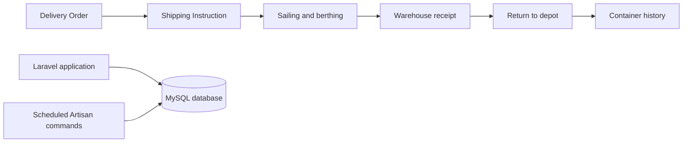

# Container management system

A Laravel application for managing delivery orders, shipping instructions, and container movement across configured branches.

The project covers the workflow from manual DO entry to warehouse receipt, return, history capture, exports, and scheduled integration processing.

  
  
  
  

## What the application does

- Creates and manages Delivery Orders with multiple item lines.
- Enforces one container as the source of truth for each DO.
- Builds Shipping Instructions from eligible DOs and warehouse transfers.
- Tracks container states from pending shipment through return to depot.
- Separates shipment status, warehouse condition, and physical storage location.
- Applies branch scope to lists, exports, downloads, and mutations.
- Processes scheduled maintenance commands through the application database.
- Produces operational Excel reports and document exports.
- Stores container damage evidence and uploaded SI documents.
- Runs demurrage, history, and maintenance jobs through the Laravel scheduler.

## Workflow

## Technical highlights

### Direct role-based authorization

Authorization uses Spatie Permission directly on the `User` model.

- Users receive roles through `model_has_roles`.
- Roles receive permissions through `role_has_permissions`.
- Routes use Spatie's `permission` middleware.
- `super-admin` uses a Gate bypass.
- Branch access remains a separate data-scope concern.

### Container lifecycle model

`ContainerData` stores the current container state. The application keeps these concerns separate:

- Shipment lifecycle status
- Warehouse condition
- Warehouse location
- SI destination
- Storage and demurrage windows

Container CRUD only creates or changes unlinked pending records. Once a container is linked to a DO, SI, weighbridge record, monitor, or history record, the record becomes operational and cannot be edited or hard-deleted through CRUD.

## Technology stack

| Area | Tools |
| --- | --- |
| Backend | PHP 8.3+, Laravel 13 |
| Database | MySQL |
| Authentication | Laravel session guard, Sanctum API authentication |
| Authorization | Spatie Laravel Permission |
| Exports | Laravel Excel, FastExcel |
| Frontend | Blade, Vue 2, jQuery, Bootstrap, Select2, ApexCharts |

## Application modules

| Module | Description |
| --- | --- |
| Authentication and access | Login, users, roles, permissions, and branch scope |
| Master data | Branches, warehouses, consignees, employees, divisions, and items |
| Delivery Orders | Manual DO entry, item lines, container linkage, voiding, and closure rules |
| Shipping Instructions | SI planning, transfer handling, monitor creation, documents, and status changes |
| Container lifecycle | Container list CRUD, operational queues, returns, history, and damage evidence |
| Warehouse management | Receipt, storage location, condition, weight, and cargo operations |
| Reporting | Excel exports, dashboard summaries, and SI documents |
| Scheduled work | Demurrage, history, and maintenance commands |

## License

This project is released under the MIT license.
